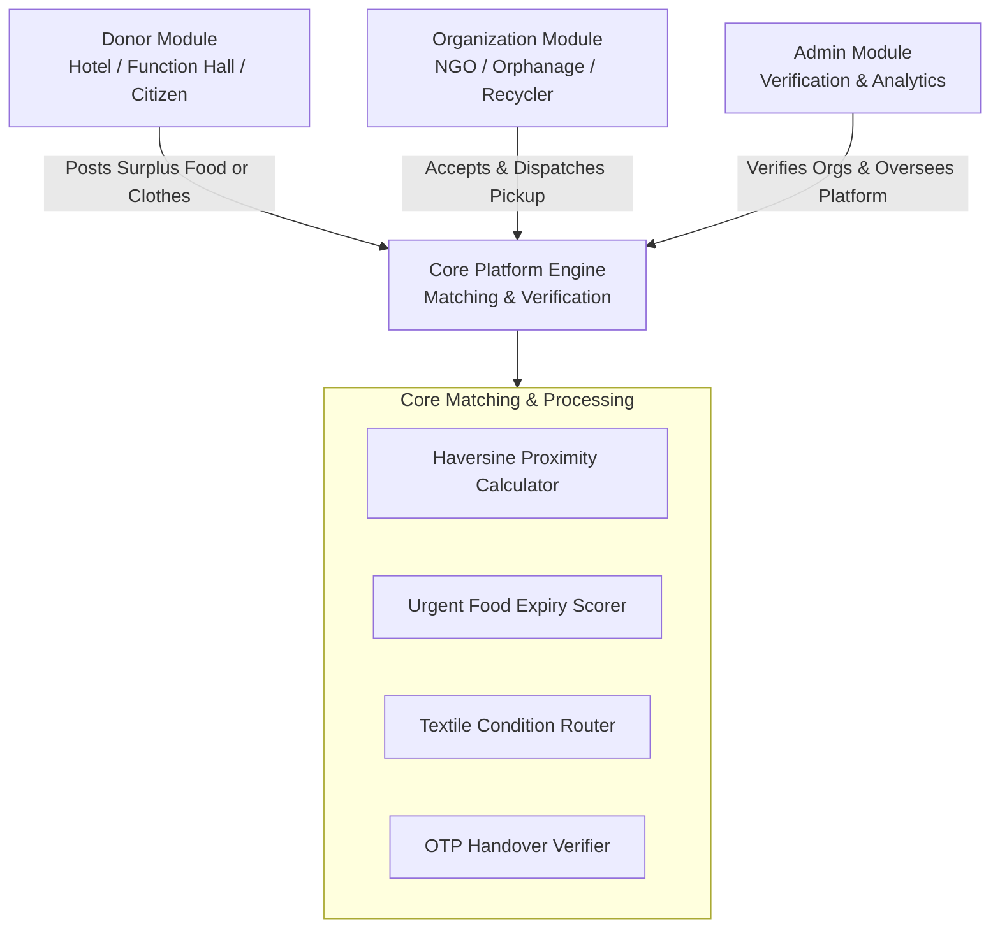
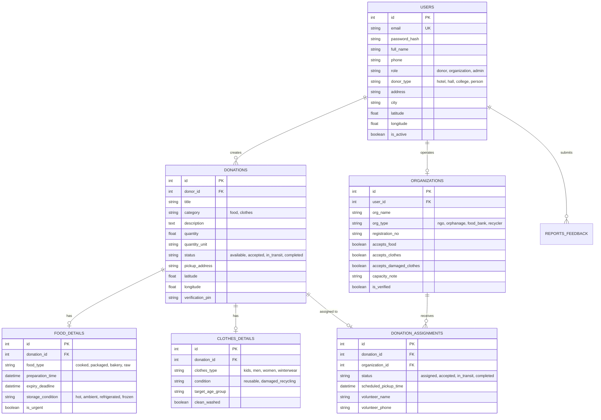

# Share & Reuse: Academic Project Structure & Synopsis

**Course / Level:** 5th Semester Computer Science & Engineering / Information Science  
**Project Title:** Share & Reuse — Intelligent Location-Aware Surplus Food and Textile Redistribution Platform  
**Target Domain:** Web Technologies, Sustainable Computing, Social Welfare Systems  
**Case Study Location:** Bagalkote, Karnataka  

---

## 1. Problem Statement
Across urban and semi-urban communities, massive volumes of edible food and wearable clothing are dumped into municipal landfills every day, creating environmental degradation while nearby shelter homes suffer shortages:

1. **Surplus Food Waste & Perishability:**
   Hotels, banquet halls, marriage function halls, and college hostels routinely produce large quantities of cooked surplus food. Because cooked food perishes within 4 to 8 hours, donors lack a time-critical mechanism to notify verified shelters before the food spoils.
2. **Clothing Misallocation & Inefficient Sorting:**
   Traditional cloth collection drives do not segregate clothes based on condition. Wearable clothes often get dumped haphazardly, while torn or damaged fabric gets sent to charity homes that have no capacity to process scrap textiles.
3. **Lack of Location Proximity Matching & Verification:**
   Existing charity listings are static directories with no real-time distance calculations, leading to delays and transportation bottlenecks. Furthermore, donors hesitate to give to unverified parties without safety and delivery confirmations.

---

## 2. Objectives of the Project

- **Primary Objective:** Design and implement a centralized, responsive web platform that bridges surplus food and clothing donors with verified organizations and textile recyclers.
- **Specific Objectives:**
  1. Implement a **Location-Based Proximity Engine** using the **Haversine Distance Formula** to rank organizations by geographic proximity in kilometers.
  2. Implement an **Urgent Food Matching Algorithm** that monitors food preparation times, storage conditions, and expiry deadlines, triggering immediate alerts when shelf life is under 4 hours.
  3. Formulate a **Dual-Stream Textile Segregation Workflow** routing wearable clothes to orphanages/old-age homes and damaged scrap fabric to textile upcycling/recycling centers.
  4. Ensure security and accountability through **Admin NGO verification** and a **4-Digit OTP Handover Protocol**.
  5. Provide analytical dashboards with **Chart.js visualizations** and **Appreciation Certificates** to encourage zero-waste practices.

---

## 3. System Architecture & Modules

The platform is divided into four functional modules:

### Module 1: Donor Management
- Multi-role registration (Individual, Hotel, Function Hall, College Hostel, Corporate).
- Dynamic creation forms for Food (type, quantity, prep time, deadline, storage condition) and Clothes (classification, wearable vs. damaged scrap).
- Interactive Leaflet map pin selector with Bagalkote landmark presets.
- Real-time donor dashboard displaying active listings, assigned vehicles, and secret 4-digit handover PIN.

### Module 2: Receiver / Organization Management
- Registration with trust/NGO registration number, capacity statements, and item acceptance capabilities.
- Live dashboard displaying nearby matching surplus donations sorted by distance and urgency.
- Urgent food ticker banner highlighting hot meals expiring within 4 hours.
- One-click pickup acceptance with volunteer driver assignment and scheduled arrival times.
- Physical handover completion via OTP entry.

### Module 3: Matching & Routing Engine
- **Haversine Distance Engine:** Calculates great-circle distance between donor GPS coordinates and partner facilities.
- **Urgent Food Priority Scoring:** Re-ranks organizations closer to the donor when time remaining is low ($t \le 4\text{ hours}$).
- **Textile Routing Filter:** Prevents damaged scrap from reaching orphanages while channeling it directly to MSME textile recyclers.

### Module 4: Administrative Governance & Analytics
- Review and verify newly registered organizations (Approve / Reject).
- User directory control (activate / suspend accounts).
- Platform monitoring and complaint resolution.
- Impact analytics powered by Chart.js (category breakdown, monthly progress, waste diversion metrics).

---

## 4. Database Schema (Entity-Relationship)

---

## 5. Matching Algorithm Formulation

### 5.1 Haversine Distance Formula
Given donor coordinates $(lat_1, lon_1)$ and candidate organization coordinates $(lat_2, lon_2)$:

$$\Delta \phi = \text{radians}(lat_2 - lat_1), \quad \Delta \lambda = \text{radians}(lon_2 - lon_1)$$

$$a = \sin^2\left(\frac{\Delta \phi}{2}\right) + \cos(\phi_1) \cdot \cos(\phi_2) \cdot \sin^2\left(\frac{\Delta \lambda}{2}\right)$$

$$c = 2 \cdot \arctan2(\sqrt{a}, \sqrt{1 - a})$$

$$\text{Distance } d = R \cdot c \quad (\text{where } R = 6371\text{ km})$$

### 5.2 Composite Match Score Calculation

1. **Proximity Base Score:**
   $$\text{Score}_{\text{base}} = \max\left(0, 100 - (2 \times d)\right)$$

2. **Urgency Weighting (For Cooked Surplus Food):**
   $$t_{\text{remaining}} = \text{expiry\_deadline} - \text{now()}$$
   - If $t_{\text{remaining}} \le 4.0\text{ hours}$ and $d \le 10\text{ km}$: $\text{Score} = \text{Score}_{\text{base}} + 35$
   - If $t_{\text{remaining}} \le 4.0\text{ hours}$ and $d > 20\text{ km}$: $\text{Score} = \text{Score}_{\text{base}} - 20$ (penalized due to transit risk)

3. **Textile Routing Filter:**
   - If $\text{condition} = \text{'damaged\_recycling'}$: Filter candidate orgs where $\text{org\_type} = \text{'recycler'}$ or $\text{accepts\_damaged\_clothes} = \text{True}$.
   - If $\text{condition} = \text{'reusable'}$: Route with $+25$ compatibility bonus to orphanages, old-age homes, and community NGOs.

---

## 6. UI Screens & Navigation Architecture

| Screen # | Screen Title | Key Functional Highlights |
| :---: | :--- | :--- |
| **1** | **Landing / Home Page** | Real-time impact counters (kg food saved, clothes items shared), 4-step workflow, urgent food alert showcase, recent available feed. |
| **2** | **Sign In Screen** | Multi-role authentication with **1-click test credentials** for Donor, Orphanage, Recycler, and Administrator. |
| **3** | **Registration Screen** | Dual-tab registration for Donors (Hotel, Hall, Citizen) & Organizations (NGO, Shelter, Recycler) with Bagalkote landmark selector. |
| **4** | **Donor Dashboard** | Overview of active listings, volume counters, active transit tracker, and secret OTP PIN display. |
| **5** | **Create Donation Screen** | Dynamic category form with urgent food deadline picker, thermal condition dropdown, clothes condition switch, and interactive Leaflet map pin selector. |
| **6** | **Nearby Matching Orgs** | Interactive Leaflet proximity map plotting donor and candidate centers with dashed distance lines, transit estimates, and direct request dispatch. |
| **7** | **Donation Details Screen** | Comprehensive specifications, contact cards, and live 4-step progress tracker (*Listed $\rightarrow$ Accepted $\rightarrow$ En Route $\rightarrow$ Completed*). |
| **8** | **Organization Dashboard** | Urgent food alert ticker with countdown timers, category filters, distance badges, and pickup dispatch modal. |
| **9** | **Accepted Pickups Management** | Dispatch schedule roster, driver status toggles, and OTP PIN input modal to finalize physical handover. |
| **10** | **Donation History & Certificate** | Historical impact ledger and a **Printable Certificate of Appreciation** formatted for sustainability credits. |
| **11** | **Admin Dashboard** | Chart.js interactive charts, organization verification queue, user management directory, and complaint resolution desk. |
| **12** | **Feedback & Complaint Desk** | Direct issue reporting for food safety, driver no-shows, or volunteer praise. |

---

## 7. Technology Stack Rationale

| Layer | Technology | Rationale / Benefits for 5th Semester |
| :--- | :--- | :--- |
| **Backend** | Python 3.13 + Flask 3.1 | Clean, lightweight, modular MVC architecture; straightforward routing and session management. |
| **Database** | SQLite & MySQL 8.0 | Dual-mode support: instant zero-configuration local runs via SQLite with complete production MySQL schemas for lab evaluations. |
| **ORM** | Flask-SQLAlchemy | Robust relational modeling, automated foreign key constraints, and declarative query syntax. |
| **Frontend** | HTML5, CSS3, JavaScript | Lightweight and responsive without heavy frontend framework dependencies. |
| **UI Framework** | Bootstrap 5.3 + Bootstrap Icons | Modern, mobile-responsive grid, modals, and status badges. |
| **Mapping** | Leaflet.js + OpenStreetMap | Free, open-source geospatial visualization without expensive Google Maps API billing. |
| **Charts** | Chart.js | Client-side responsive doughnut and bar charts for the administrative dashboard. |

---

## 8. Team Member Work Distribution (4-Member Division)

| Member | Role | Assigned Modules & Deliverables |
| :--- | :--- | :--- |
| **Member 1 (Team Lead)** | System Architect & Backend Developer | Core Flask structure (`app.py`, `config.py`), database schemas, authentication middleware, session guards, and automated test suite. |
| **Member 2** | Algorithm & Geospatial Specialist | Matching engine (`matching.py`), Haversine distance formula, urgent food shelf-life priority scoring, and Leaflet.js interactive maps. |
| **Member 3** | UI/UX & Frontend Developer | Jinja2 templates (`base.html`, `index.html`, `create_donation.html`, `donor_dashboard.html`), responsive CSS styling, and countdown timers. |
| **Member 4** | Database & Admin Specialist | Database seeding (`seed_data.py`, `schema.sql`), Admin console (`admin_dashboard.html`), Chart.js analytics, and certificate generator. |

*(If completing as an individual project, all modules are structured in an integrated manner for single-author demonstration).*

---

## 9. Innovation & Real-World Impact

1. **Urgent Hot-Meal Matching:**  
   Most existing platforms treat food as non-perishable goods. Share & Reuse specifically accounts for hot cooked banquets expiring within hours, ensuring fast dispatch before spoilage.
2. **Textile Circular Economy:**  
   By segregating wearable clothes from damaged textiles, the platform prevents charitable homes from becoming dumpsites for torn clothes while providing feedstock to recycling mills.
3. **Verified Handover Security:**  
   The 4-digit pickup PIN prevents fraudulent collections and gives donors confidence that their contributions reach genuine beneficiaries.
4. **Local Proximity Optimization:**  
   Focusing on intra-city zones (demonstrated with Bagalkote landmarks: Vidyagiri, Navanagar, Station Road, APMC, KIADB) drastically cuts delivery travel times and carbon emissions.

---

## 10. Formal Academic Synopsis

### Title
**SHARE & REUSE: AN INTELLIGENT WEB-BASED REDISTRIBUTION PLATFORM FOR SURPLUS FOOD AND CLOTHING UTILIZING LOCATION-AWARE MATCHING ALGORITHMS**

### Abstract
Food wastage and textile disposal represent two of the most pressing socio-environmental challenges in developing urban ecosystems. Commercial banquet halls, restaurants, and educational mess facilities frequently discard substantial quantities of hygienic cooked food due to a lack of immediate, location-aware distribution networks. Simultaneously, cloth donation drives frequently suffer from poor quality segregation, where non-wearable scrap garments are dumped on charitable homes lacking textile processing capacity.

This project presents **Share & Reuse**, an intelligent, full-stack web platform built using Python Flask, SQLAlchemy, MySQL, and Leaflet Maps. The system introduces a dual-category redistribution architecture: (i) an **Urgent Food Rescue Protocol** that tracks preparation timestamps, thermal storage conditions, and expiry thresholds to alert nearby shelters when shelf-life is critical ($\le 4\text{ hours}$), and (ii) an **Automated Textile Segregation Pipeline** that channels wearable clothing to orphanages and old-age homes while redirecting damaged fabrics to certified industrial upcycling facilities. Proximity optimization is achieved through the **Haversine Distance Algorithm**, and physical handovers are secured via an **OTP Verification Protocol**. Experimental deployment and testing demonstrate seamless end-to-end operation, providing an impactful, transparent, and reproducible technical solution for community zero-waste management.
